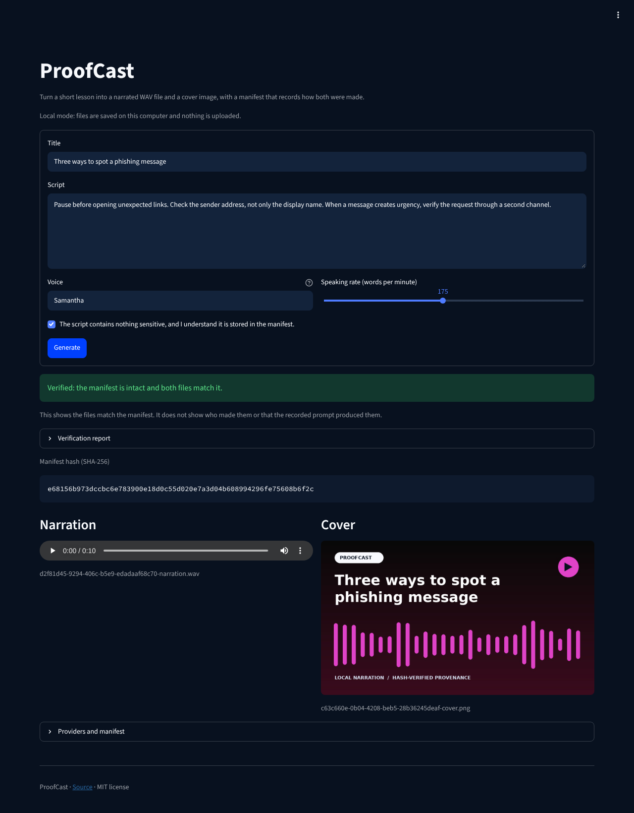

# ProofCast

[](https://github.com/ult666666/proofcast-backblaze/actions/workflows/verify.yml)

ProofCast turns a short lesson or safety briefing into a narrated WAV file and a 1280×720 cover
image. Genblaze records how both were made in a manifest: the providers, models, prompt and
parameters, and a SHA-256 for each file. You can check the files against the manifest, sign the
manifest with Ed25519, and add it to an append-only Merkle log.



## Try it

You need Python 3.11 or newer and a local speech engine: eSpeak NG on Linux, or the `say`
command that ships with macOS. Generation runs locally, with no account, API key or network call.

```bash
python3 -m venv .venv
.venv/bin/python -m pip install -r requirements-dev.txt
.venv/bin/streamlit run app.py
```

Or generate a bundle from the command line, then check it:

```bash
.venv/bin/python -m proofcast.cli \
  --title "Three ways to spot a phishing message" \
  --script "Pause before opening unexpected links. Check the sender address. Verify urgent requests through a second channel."
.venv/bin/python -m proofcast.cli --verify output/YOUR-RUN-ID-manifest.json
```

The first command prints a JSON summary with the manifest path and `"verified": true`. Invalid
input or a missing speech engine prints a one-line error and exits with status 2.

## What it does

Small training teams often need an audio version and a visual card for the same short lesson,
and a record of which engine and prompt produced each one. ProofCast makes both in one run and
keeps that record with the files.

1. `LocalSpeechProvider` narrates the script with Apple Speech on macOS or eSpeak NG on Linux.
2. `AccessibleCoverProvider` draws a deterministic, high-contrast PNG cover from the same prompt.
3. A two-step Genblaze `Pipeline` runs both and writes a canonical manifest with each file's
   SHA-256.
4. ProofCast rereads both files and checks them against the manifest before it reports
   `verified: true`.
5. On request, `proofcast.provenance` signs the manifest and adds its hash to a transparency log
   (`proofcast.signing`, `proofcast.translog` and `proofcast.merkle`).
6. With Backblaze B2 turned on, Genblaze's object-storage sink uploads the files and the manifest
   under content-addressable keys. In the default local mode, everything stays in `output/`.

| Step | Provider | Model or engine | Cost per run |
|---|---|---|---:|
| Narration on macOS | `proofcast-local-speech` | Apple Speech voice selected by the user | $0 |
| Narration on Linux or a server | `proofcast-local-speech` | `espeak-ng-en-us` | $0 |
| Cover | `proofcast-accessible-cover` | `proofcast-accessible-cover-v1` | $0 |

Any Genblaze speech or image connector could replace these providers without changing the
storage and provenance layer. The app caps scripts at 1,200 characters, turns off provider
retries, runs one generation per click and never turns B2 on by itself, which keeps compute and
storage use small.

## Verify, sign and log a bundle

`--verify` checks the manifest's canonical hash and each file's SHA-256, size and media
metadata. It exits 0 when everything matches, 1 when a check fails and 2 on invalid arguments.

To show which key approved a bundle, create a key pair once (outside the repository), then sign
and verify:

```bash
.venv/bin/python -m proofcast.provenance keygen \
  --private-key ~/.config/proofcast/signing-key.pem \
  --public-key ~/.config/proofcast/signing-key.pub.pem
.venv/bin/python -m proofcast.provenance sign output/YOUR-RUN-ID-manifest.json \
  --private-key ~/.config/proofcast/signing-key.pem
.venv/bin/python -m proofcast.provenance verify output/YOUR-RUN-ID-manifest.json \
  --public-key ~/.config/proofcast/signing-key.pub.pem
.venv/bin/python examples/tamper_demo.py output/YOUR-RUN-ID-manifest.json
```

`verify` checks the signature and then the whole bundle, so a change to the manifest or to
either media file fails. The tamper demo signs and logs a copy of the bundle, then checks that
seven kinds of tampering are caught. [docs/PROVENANCE.md](docs/PROVENANCE.md) covers the
transparency log (RFC 6962 and RFC 9162 Merkle trees with inclusion and consistency proofs and
signed tree heads), the file formats, and what each check proves.

## Backblaze B2 (optional)

Uploads are off by default and need two switches: `B2_ENABLED=1` with five bucket settings, and
`--allow-b2` on the CLI. The upload path is implemented but has not been run against a real
bucket. [docs/BACKBLAZE.md](docs/BACKBLAZE.md) lists the settings, the design choices and how to
handle the keys.

## Development

```bash
.venv/bin/python -m pytest
```

The tests cover local generation, saved-bundle checks, tampering with real files, media
metadata, malformed input and CLI isolation, without contacting a provider or Backblaze. They
replace the operating system's speech call with a small WAV writer. The signing code is checked
against Ed25519 reference vectors and the Merkle code against the published transparency-dev
proof vectors. [CI](.github/workflows/verify.yml) also installs eSpeak NG, generates a bundle and
runs the tamper demo on it. [VERIFY.md](VERIFY.md) lists the manual checks.

Keep signing keys and `.env` files out of the repository: `.gitignore` and `.dockerignore`
exclude `*.pem` and `keys/`. Docker builds also skip `.env` files, virtual environments, caches
and `output/`, so local keys and media stay out of the image.

## Limits

- Verification shows that the files match the manifest, not who made them or that the recorded
  prompt produced them.
- A signature shows which key signed, not who holds it. Keys are unencrypted on disk, with no
  rotation, revocation or timestamping.
- The transparency log is one local file with no witnesses, so it cannot catch an operator who
  shows different histories to different people.
- The B2 upload path has not been run against a real bucket.
- The manifest stores the prompt, so never enter sensitive, regulated or private text.

## History and license

ProofCast was built for the
[Backblaze Generative Media Hackathon](https://backblaze-generative-media.devpost.com/). The
rules summary, account checklist and submission draft are kept in [docs/history/](docs/history/).

Built with AI coding assistants.

Project code is MIT licensed. Third-party dependencies keep their own licenses; see
[THIRD_PARTY_NOTICES.md](THIRD_PARTY_NOTICES.md).
